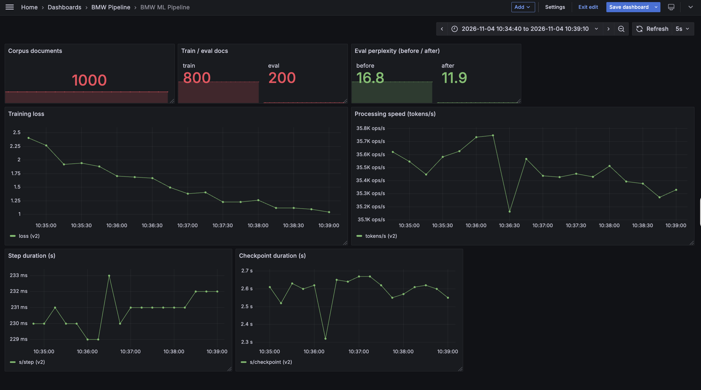

# BMW Text & ML Pipeline

Collects English-language BMW Group newsroom articles, fine-tunes a small
open model (SmolLM2-360M) on the corpus, evaluates it on held-out data, and
reports every step's metrics to a Grafana dashboard provisioned from this
repository.

```
  make collect -> make prepare -> make train -> make evaluate -> make generate
   data/raw/      data/processed/  artifacts/     artifacts/eval/  artifacts/generations/
                                     checkpoints,
                                     model/
        |               |              |              |              |
        +---------------+--------------+--------------+--------------+
                                       |
                          pipeline/metrics.py (one atomic push per step)
                                       |
                                       v
                         Pushgateway --> Prometheus --> Grafana
                                                |
                                                +--> Alertmanager
```

## Architecture overview

The pipeline has five independently runnable steps, one orchestration layer,
and one observability path:

| Layer | Components | Responsibility |
|---|---|---|
| Data plane | `pipeline/collect.py`, `pipeline/prepare.py`, `pipeline/data.py` | Discover articles via the sitemap, parse JSON-LD + prose, deduplicate, clean, hash-split, tokenize into 512-token blocks |
| Training | `pipeline/train.py` | Full fine-tune of SmolLM2-360M with a plain PyTorch loop, atomic checkpoints, automatic resume |
| Evaluation / generation | `pipeline/evaluate.py`, `pipeline/generate.py` | Held-out perplexity before vs. after; side-by-side prompt completions |
| Control plane | `Makefile`, `pipeline/config.py` | One idempotent target per step; every tunable knob in one place, with `BMW_*` overrides |
| Storage | `data/raw/`, `data/processed/`, `artifacts/` | Per-article JSON, train/eval JSONL, checkpoints, exported model, eval results, generations, logs |
| Observability | `pipeline/metrics.py`, `monitoring/` | Push metrics to Pushgateway; Prometheus stores them and evaluates alerts; Grafana and Alertmanager consume them |

The design favours restartability over framework features: collection and
preparation are idempotent, training checkpoints contain model, optimizer,
scheduler and RNG state, and a restart simply loads the newest
`artifacts/checkpoints/step-*.pt`. Checkpoints are written to a `.tmp` file
and renamed into place, so even `kill -9` cannot leave a half-written
checkpoint.

## Requirements

- Python 3.10+; `make install` (torch is provided by the host environment)
- A CUDA GPU is recommended (an A100 was used here); CPU works but is slow
- ~10 GB free disk for the main run (each checkpoint is ~4.1 GB, the last 2
  are kept); ~20 GB if you also run the resume demo
- Internet for the first run (BMW newsroom + Hugging Face model download);
  `make monitoring-up` downloads ~350 MB of pinned binaries on first use

## Quickstart

```bash
make install
make verify-env          # libraries, GPU, pinned model revision
make collect             # first run roughly 25 min (1,000 articles, polite delays); re-runs ~1 s
make prepare
make monitoring-up       # Prometheus, Alertmanager, Grafana, Pushgateway
make train               # safe to interrupt and re-run
make evaluate
make generate
```

For a fast end-to-end check without the GPU/large corpus:

```bash
make smoke               # 3 articles / 5 steps in throwaway directories
```

Then open Grafana at <http://localhost:3000> (`admin/admin`) -> folder
**BMW Pipeline**, and set the time range to cover the run (for example
**Last 6 hours**) so the loss and speed panels are visible.

## Pipeline steps

| Step | Command | What it does | Output |
|---|---|---|---|
| 1 | `make collect` | sitemap -> articles, dedupe by URL + content hash | `data/raw/*.json` |
| 2 | `make prepare` | clean, deterministic hash split 80/20 | `data/processed/{train,eval}.jsonl` |
| 3 | `make train` | fine-tune, atomic checkpoints, auto-resume | `artifacts/checkpoints/`, `artifacts/model/` |
| 4 | `make evaluate` | held-out perplexity, before vs. after | `artifacts/eval/results.json` |
| 5 | `make generate` | BMW prompts, fine-tuned vs. base model | `artifacts/generations/generations.md` |

All five targets are safe to re-run. Collection stops at the `MAX_DOCS`
corpus target instead of adding documents per run; preparation rewrites the
same split byte-for-byte; training resumes from the newest checkpoint; and
evaluation/generation overwrite their own outputs.

## Interruption and resume

Training checkpoints every `CHECKPOINT_EVERY` steps (default 50). To resume
after a crash, kill, or reboot, run `make train` again. It loads the newest
`artifacts/checkpoints/step-*.pt` and continues from that step; model,
optimizer, scheduler and RNG state are restored.

Prove it end-to-end with the automated demo:

```bash
./scripts/demo_resume.sh
```

It trains into a throwaway `demo-artifacts/` directory, waits for two
checkpoints, sends `kill -9`, restarts, and prints the resume evidence. The
demo needs roughly the same disk space as a main run (~10 GB) because it
keeps its own two checkpoints and model export.

## Monitoring

| Component | URL | Purpose |
|---|---|---|
| Grafana | <http://localhost:3000> | dashboard (admin/admin) |
| Prometheus | <http://localhost:9090> | metrics storage, `/alerts` |
| Alertmanager | <http://localhost:9093> | firing alerts |
| Pushgateway | <http://localhost:9091> | batch-job metrics inbox |

Check that it works:

```bash
curl -s localhost:9090/-/healthy      # Prometheus Server is Healthy.
curl -s localhost:9091/-/ready        # OK
curl -s localhost:9093/-/healthy      # OK
curl -s localhost:3000/api/health     # {"database":"ok",...}
```

Prometheus targets (<http://localhost:9090/targets>) must both be UP.
Useful queries in the Prometheus UI: `bmw_corpus_docs`,
`bmw_train_loss`, `bmw_train_tokens_per_second`, `bmw_eval_perplexity`.

The dashboard is provisioned from `monitoring/grafana/` (datasource and
dashboard JSON); nothing is configured by hand in the UI. The current
screenshot is `assets/monitoring_dashboard.png`.

### Alerts

| Alert | Fires when | First response |
|---|---|---|
| `BmwTrainingStalled` | no training metric push for 5+ min | check the training log, run `make train` (it resumes) |
| `BmwCollectionErrorRateHigh` | >10% of the last collection's fetches failed | check connectivity / the site; re-run `make collect` |

Both rules live in `monitoring/alerts.yml` and are versioned. Their
annotations include the first response for the on-call engineer.

### Metrics pushed by each step

| Step | Metrics |
|---|---|
| collect | `bmw_collect_docs{status=ok\|duplicate\|error\|skipped}`, `bmw_collect_new_docs`, `bmw_corpus_docs`, `bmw_collect_duration_seconds` |
| prepare | `bmw_docs_split{split=train\|eval}`, `bmw_prepare_duration_seconds` |
| train | `bmw_train_loss`, `bmw_train_global_step`, `bmw_train_step_duration_seconds`, `bmw_train_checkpoint_duration_seconds`, `bmw_train_tokens_per_second` |
| evaluate | `bmw_eval_perplexity{phase=before\|after}`, `bmw_eval_loss`, `bmw_eval_duration_seconds` |
| generate | `bmw_generation_prompts`, `bmw_generation_duration_seconds` |

Metrics pushes are best-effort: with the stack down the pipeline still runs,
it just warns once.

## Configuration

All knobs are constants in `pipeline/config.py`; selected ones can be
overridden with `BMW_*` environment variables (used by `make smoke` and the
demo scripts to run throwaway copies of the same code paths).

```bash
make smoke                          # full pipeline on 3 articles / 5 steps
BMW_MAX_STEPS=1000 make train       # train longer
BMW_RUN_ID=exp2 make train          # separate loss curve for a new run
```

The reported run uses the defaults (`MAX_DOCS=1000`, `MAX_STEPS=800`).
Monitoring-specific overrides: `BMW_RUN_ID` labels a training run's series
(default `main`; keep it stable across a resume, change it for a new
experiment), and `BMW_METRICS_DISABLE=1` turns all metric pushes off
(`make smoke` sets it so throwaway runs never overwrite the dashboard).

## Results

Reported run (2026-11-04): **1,000 articles**, **800/200 train/eval split**,
held-out perplexity **16.78 -> 11.90 (-29.1%)**, and 12 generated prompt
comparisons.

Full numbers, resume evidence and the honest limitations are in
[docs/results.md](docs/results.md); the small logs and evaluation output are
in [docs/evidence/](docs/evidence/).



The dashboard image in `assets/` was captured during the reported training
run. If its evaluation stat still shows the earlier run's 13.2, run
`make monitoring-up && make evaluate` and refresh the image; the current
result is 11.9. See `docs/results.md` for details.

## Decision log

See [DECISIONS.md](DECISIONS.md) for completed, partially completed and
deliberately omitted items with their reasoning. In short:

- SmolLM2-360M, pinned to a revision hash, full fine-tune rather than LoRA.
- A custom PyTorch loop rather than the HF Trainer, because checkpoint/resume
  is the core of the assignment.
- Sitemap discovery, JSON-LD metadata and a paragraph heuristic for parsing.
- Hash-based train/eval split so a document's split never changes.
- Atomic checkpoints with optimizer/scheduler/RNG state, plus automatic
  resume.
- Pushgateway -> Prometheus -> Grafana, with datasource and dashboard
  provisioned from the repository.
- Makefile as the orchestrator; a workflow engine is unjustified at this
  scope.

## Repository layout

```
pipeline/       config, metrics, collect, prepare, data, train, evaluate, generate
monitoring/     Prometheus/Alertmanager/Grafana configs + launcher scripts
scripts/        verify_env.py (preflight), demo_resume.sh (resume proof)
docs/           results.md, interview_prep.md, evidence/
assets/         dashboard screenshot
Makefile        one target per step; `make help` lists them
```

Large outputs (`data/`, `artifacts/`) and monitoring binaries
(`monitoring/bin/`, `monitoring/runtime/`) are gitignored: they are
regenerable and too large for git. The small, reviewable evidence is kept
under `docs/evidence/`.

## Limitations and deliberate omissions

See [DECISIONS.md](DECISIONS.md). In short: English-language BMW Group
articles only (BMW, MINI, Rolls-Royce, Motorrad), a 360M base model that
adapts style rather than storing facts, no early stopping or hyperparameter
search, no CI, no model serving, and no orchestrator. The monitoring stack
runs as pinned local binaries started by `make monitoring-up`. Exact
reproduction of the corpus is limited by live-site drift; the code path and
configuration are pinned.
